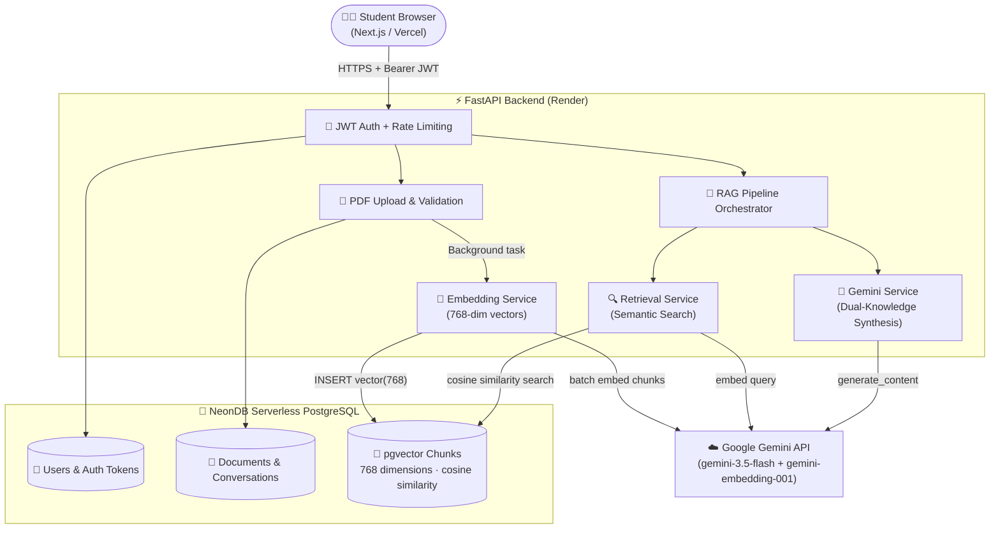

<div align="center">


<br/>

# 🎓 AKTU Notes AI

### *Chat with your Lecture Notes. Get Exam-Ready Answers. Instantly.*

**A full-stack AI-powered RAG (Retrieval-Augmented Generation) platform that lets university students upload their AKTU PDFs and ask any academic question — getting deep, structured, cited answers powered by Google Gemini.**

<br/>

[](https://mini-project-gamma-seven.vercel.app)
[](https://mini-project-jxgk.onrender.com/docs)
[](#)
[](#)
[](#)
[](#)
[](#)
[](#)

</div>

---

## ✨ What Makes This Special?

> This isn't just another chatbot. This is a **production-grade academic intelligence platform** — built from scratch — combining cutting-edge vector search, real-time streaming, and dual-knowledge AI synthesis.

When a student uploads their AKTU Data Analytics assignment sheet and asks *"what is the answer to the first question?"*, the AI doesn't just say *"the document only contains the question."*

It **reads the question from the PDF**, understands the academic context, and delivers a **complete, step-by-step, exam-worthy answer** — with citations pointing to the exact page of the uploaded document.

---

## 🎬 The Full-Stack Flow

```
Student uploads PDF  →  PyMuPDF extracts text  →  Smart chunking with overlap
        ↓
Gemini Embeddings (768-dim)  →  pgvector in NeonDB  →  Stored and indexed
        ↓
Student asks question  →  Query vectorized  →  Cosine similarity search
        ↓
Top-K semantic chunks retrieved  →  Sent to Gemini as context
        ↓
Gemini synthesizes: PDF context + Academic AI knowledge
        ↓
Structured answer with page citations  →  Streamed to React frontend
```

---

## 🏗️ Architecture



---

## 🚀 Features at a Glance

<table>
<tr>
<td width="50%">

### 🧠 AI & RAG Intelligence
- **Dual-Knowledge Synthesis** — combines your uploaded notes with Gemini's academic knowledge
- **Assignment Solver** — finds questions inside PDFs, solves them step-by-step
- **Semantic Vector Search** — 768-dim cosine similarity via pgvector in NeonDB
- **Verified Citations** — every answer cites exact PDF filename + page number
- **Hallucination Defense** — citation validation strips any unverified references
- **Conversational Memory** — multi-turn context window for follow-up questions
- **Query Augmentation** — short follow-ups enriched with conversation history for better retrieval

</td>
<td width="50%">

### 🔐 Security & Production Hardening
- **Argon2id** password hashing (memory-hard, OWASP-recommended)
- **Stateless JWT** (15-min access) + **rotating refresh tokens** (7-day)
- **Token-reuse breach detection** — server-side refresh token revocation
- **Rate limiting** on auth (5/min register, 10/min login) and RAG (30/min)
- **Magic-byte PDF verification** — rejects non-PDF files at byte level
- **UUID-isolated storage** — zero path traversal risk
- **User-scoped vector search** — users can only query their own documents

</td>
</tr>
<tr>
<td width="50%">

### ⚙️ Engineering Excellence
- **Fully async** FastAPI with SQLAlchemy 2.0 async sessions
- **Background task pipeline** for PDF processing (non-blocking uploads)
- **Live stage tracking** — frontend polls real-time processing stages
- **Automatic Alembic migrations** on every deploy
- **28 passing tests** across auth, documents, RAG, and security
- **Environment-driven config** — zero hardcoded model names
- **Docker Compose** for one-command local spin-up

</td>
<td width="50%">

### 🎨 Frontend UX
- **Real-time processing stages** — visual pipeline tracker during PDF ingestion
- **Markdown-rendered answers** with syntax highlighting
- **Verified citations panel** with document name + page badges
- **Conversation history sidebar** — persistent, paginated
- **Quick-prompt suggestions** per document type
- **Dark mode polish** — Tailwind CSS + shadcn-inspired components
- **Toast notification system** for all async feedback

</td>
</tr>
</table>

---

## 🧰 Technology Stack

| Layer | Technology | Why It Was Chosen |
|---|---|---|
| **Frontend** | Next.js 15 + TypeScript | Server components, type safety, Vercel-native deployment |
| **Styling** | Tailwind CSS | Utility-first, dark-mode, rapid custom UI |
| **Backend** | FastAPI + Python 3.12 | Async-native, auto-OpenAPI docs, production performance |
| **ORM** | SQLAlchemy 2.0 (Async) | Full async support, declarative 2.0 syntax |
| **Migrations** | Alembic | Version-controlled schema evolution |
| **Database** | NeonDB PostgreSQL (Serverless) | Branching, pgvector extension, zero infrastructure |
| **Vector Index** | pgvector `vector(768)` + cosine | Native SQL queries, no separate vector DB needed |
| **LLM** | Google Gemini (via `google-genai` SDK) | Configurable via `.env`, best-in-class reasoning |
| **Embeddings** | `gemini-embedding-001` (768-dim) | High-quality semantic representations |
| **PDF Parsing** | PyMuPDF (`fitz`) | Fast, accurate, page-number preserving text extraction |
| **Auth** | PyJWT + argon2-cffi | Industry-standard, memory-hard password security |
| **Rate Limiting** | SlowAPI | Production-ready, Redis-compatible limits |
| **Testing** | pytest + pytest-asyncio + HTTPX | Full async test coverage, in-memory SQLite isolation |
| **Containerization** | Docker + Compose | Reproducible local environments |
| **Backend Deploy** | Render.com | Auto-deploys from Git, managed TLS, `$PORT` binding |
| **Frontend Deploy** | Vercel | Edge CDN, Next.js-native, preview URLs per branch |

---

## 📁 Project Structure

```text
sankalp_project/
├── aktu-notes-ai-backend/            # FastAPI + RAG Engine
│   ├── app/
│   │   ├── main.py                   # FastAPI lifespan, CORS, exception handlers
│   │   ├── core/
│   │   │   ├── config.py             # Pydantic Settings (env-driven)
│   │   │   ├── security.py           # Argon2id + JWT
│   │   │   ├── dependencies.py       # DB injection, auth guard, rate limiting
│   │   │   └── exceptions.py         # Typed exception hierarchy
│   │   ├── api/v1/
│   │   │   ├── auth.py               # Register, Login, Refresh, Logout
│   │   │   ├── documents.py          # Upload, Status, List, Delete, Retry
│   │   │   └── chats.py              # Ask, Conversations, History
│   │   ├── services/
│   │   │   ├── gemini_service.py     # 🤖 Dual-knowledge AI synthesis
│   │   │   ├── retrieval_service.py  # 🔍 Query embed + semantic search
│   │   │   ├── embedding_service.py  # 📐 Batch vectorization with retry
│   │   │   ├── chunking_service.py   # ✂️ Sentence-boundary overlap chunker
│   │   │   ├── pdf_service.py        # 📄 PyMuPDF extraction + scanned detection
│   │   │   ├── vector_service.py     # 🧮 pgvector insert + cosine similarity
│   │   │   └── chat_service.py       # 🧵 RAG orchestration + context memory
│   │   ├── models/                   # SQLAlchemy ORM models
│   │   ├── repositories/             # Clean data access layer
│   │   └── tasks/
│   │       └── document_tasks.py     # Background: extract → chunk → embed → store
│   ├── alembic/versions/             # Database migration scripts
│   ├── tests/                        # 28 passing automated tests
│   ├── Dockerfile                    # Multi-stage production image
│   ├── docker-compose.yml            # Full local stack
│   ├── render.yaml                   # Render deployment config
│   └── requirements.txt
│
└── aktu-notes-ai-frontend/           # Next.js 15 + TypeScript
    └── src/
        ├── app/                      # Next.js App Router
        ├── components/
        │   ├── chat/ChatArea.tsx     # Message stream + citation cards
        │   ├── documents/            # Upload, status, pipeline tracker
        │   ├── auth/                 # Login/register modals
        │   └── landing/HeroSection.tsx
        ├── context/                  # Auth, Document, Toast state
        └── lib/api.ts                # Typed API client
```

---

## ⚡ Quick Start (Local Development)

### Prerequisites
- Python 3.12+
- Node.js 18+
- A [NeonDB](https://neon.tech) PostgreSQL database (free tier works)
- A [Google AI Studio](https://aistudio.google.com) API key (free)

### 1. Clone the repo
```bash
git clone https://github.com/surajpandey230522-cloud/mini_project.git
cd mini_project
```

### 2. Backend setup
```bash
cd aktu-notes-ai-backend

# Create virtual environment
python -m venv .venv
.\.venv\Scripts\Activate.ps1   # Windows
# source .venv/bin/activate    # macOS/Linux

# Install dependencies
pip install -r requirements.txt

# Configure environment
cp .env.example .env
# Edit .env with your DATABASE_URL and GEMINI_API_KEY
```

### 3. Run migrations & start server
```bash
alembic upgrade head
uvicorn app.main:app --reload --port 8000
```

🔗 API docs live at: **http://localhost:8000/docs**

### 4. Frontend setup
```bash
cd ../aktu-notes-ai-frontend
npm install

# Set backend URL
echo "NEXT_PUBLIC_API_URL=http://localhost:8000" > .env.local

npm run dev
```

🌐 Frontend live at: **http://localhost:3000**

---

## 🌐 Deployment

The entire platform is **production-deployed and publicly accessible:**

| Service | Platform | URL |
|---|---|---|
| **Frontend** | Vercel | [mini-project-gamma-seven.vercel.app](https://mini-project-gamma-seven.vercel.app) |
| **Backend API** | Render | [mini-project-jxgk.onrender.com](https://mini-project-jxgk.onrender.com/docs) |
| **Database** | NeonDB Serverless | PostgreSQL 16 + pgvector |

### Deploy your own in minutes

**Backend → Render:**
```yaml
# render.yaml is already configured. Just:
# 1. Connect your GitHub repo to Render
# 2. Add environment variables in the dashboard
# 3. Click Deploy — Alembic migrations run automatically on start
```

**Frontend → Vercel:**
```bash
# vercel.json is pre-configured
# 1. Import the aktu-notes-ai-frontend folder in Vercel
# 2. Set NEXT_PUBLIC_API_URL to your Render backend URL
# 3. Deploy — done.
```

---

## 🔌 Key API Endpoints

```
POST   /api/v1/auth/register          Register a new student
POST   /api/v1/auth/login             Login and receive JWT tokens
POST   /api/v1/auth/refresh           Rotate access token silently
POST   /api/v1/auth/logout            Revoke refresh token

POST   /api/v1/documents              Upload PDF (triggers background pipeline)
GET    /api/v1/documents              List user's documents with status
GET    /api/v1/documents/{id}         Get processing stage + progress
DELETE /api/v1/documents/{id}         Delete doc + vectors + physical file

POST   /api/v1/chats/ask              Ask a question (full RAG pipeline)
GET    /api/v1/chats/conversations    List conversation history
GET    /api/v1/chats/conversations/{id}  Full message thread with citations
```

**Sample RAG Response:**
```json
{
  "conversation_id": "c61b2a99-...",
  "answer": "## Stream Data Model\n\nA **stream data model** treats data as an unbounded, ordered sequence of events...\n\n### Architecture Components:\n- **Data Sources** — sensors, logs, transactions\n- **Stream Processor** — Apache Kafka / Flink\n...",
  "citations": [
    {
      "filename": "Data_Analytics_Assignment_II.pdf",
      "page_number": 1,
      "chunk_id": "abc123_chunk_0001"
    }
  ],
  "grounded": true
}
```

---

## 🧪 Testing

The test suite runs **completely offline** — in-memory SQLite + mock Gemini client. No live API keys needed.

```bash
cd aktu-notes-ai-backend
pytest -v
```

```
✅ test_auth.py          ::  10 passed  — register, login, refresh, logout, breach detection
✅ test_documents.py     ::   6 passed  — upload, validation, status, deletion
✅ test_rag.py           ::   5 passed  — PDF extraction, chunking, vector search, full pipeline
✅ test_security.py      ::   7 passed  — JWT tampering, Argon2id, rate limits, CORS
─────────────────────────────────────────────────────
                        28 passed in < 5s
```

---

## 🔒 Security Design

| Threat | Defense |
|---|---|
| Weak passwords | Argon2id (memory-hard, salted, 64MB RAM cost) |
| Token theft | 15-min access tokens, 7-day rotating refresh |
| Refresh token reuse | Server-side revocation + reuse attack detection |
| File upload attacks | Magic-byte `%PDF-` check + MIME validation + UUID storage |
| Path traversal | UUID-based filesystem isolation |
| Cross-user data access | User-scoped SQL filters on every query + vector search |
| Brute-force | SlowAPI rate limits: 5/min register, 10/min login |
| Prompt injection via PDF | System instruction isolation in Gemini config |
| Citation hallucination | Backend validates every returned chunk_id against retrieved set |

---

## 🛣️ Engineering Decisions

> *Why these choices, and what do they reveal about the engineering thinking?*

**🧮 pgvector over Pinecone/Weaviate** — Keeping vectors in the same PostgreSQL instance as relational data means transactional consistency: when a document is deleted, its vectors are gone atomically. No eventual consistency bugs, no extra infrastructure, no cost.

**📐 768-dim over 1536-dim** — `gemini-embedding-001` at 768 dimensions gives excellent semantic recall at half the storage cost per vector row, with zero quality degradation on academic text.

**🔁 Overlap chunking (100-token overlap)** — Academic definitions and theorems often span paragraph boundaries. 100-token overlap ensures no concept gets split between chunks and lost during retrieval.

**🤖 Dual-knowledge synthesis** — Pure RAG (PDF-only) fails on assignment sheets that contain only questions. The hybrid approach solves the actual student use-case: *"I have my assignment. Help me understand and answer it."*

**⚡ Background tasks for PDF processing** — Embedding 300 pages synchronously would timeout HTTP requests. Offloading to `asyncio.to_thread` keeps uploads instant and progress is polled by the frontend.

---

## 👨‍💻 About The Developer

Built by **Suraj Pandey** — a full-stack developer who takes AI projects from idea to production, handling everything from vector database design to Tailwind UI, JWT security architecture to Gemini prompt engineering.

> This project was built as a university mini-project — but engineered at a production standard with real users, live deployment, and security design that would hold up in a code review.

---

<div align="center">

**If you found this interesting, please ⭐ star the repository!**

[](https://github.com/surajpandey230522-cloud/mini_project)

<sub>Built with 💜 for AKTU students everywhere</sub>

</div>
